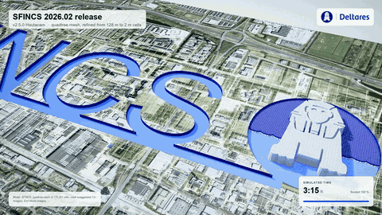

=========================================
SFINCS: Super-Fast INundation of CoastS 
=========================================

|website| |docs_latest| |docs_stable| |license| |doi| |journal|

What is SFINCS?
-------------------------------------------------------
SFINCS is Deltares' new open-source, open-access reduced-complexity model designed for super-fast modelling of compound flooding events in a dynamic way!

Deltares is a not-for-profit independent institute for applied research in the field of water, subsurface and infrastructure. 

Why SFINCS?
-------------------------------------------------------
Compound flooding during extreme events can result in tremendous amounts of property damage and loss of life. Early warning systems and multi-hazard risk analysis can reduce these impacts. However, traditional approaches either do not involve relevant physics or are too computationally expensive to do so for large stretches of coastline. The SFINCS model is a new reduced-complexity engine recently developed by Deltares, that is capable of simulating compound flooding including a high computational efficiency balanced with good accuracy.

Acknowledge our efforts when using SFINCS for your own work
-----------------------------------------------------------
When using SFINCS in your research or projects, please cite the relevant papers and the DOI of the release you used, and acknowledge Deltares, HydroMT-SFINCS, SFINCS and its open-source community.
SFINCS is brought to you by the collaborative efforts of the Deltares team and the wider SFINCS and HydroMT-SFINCS open-source, open-access community.
Developing excellent software takes significant time and effort, and funding, from Deltares and partners.

We greatly appreciate any acknowledgment and support from the community when using SFINCS in your work.
By doing research and projects together, involving us in papers and research proposals, getting help through SFINCS service contracts, following trainings, sharing bugfixes and improvements - we all benefit and contribute to the continued development and success of SFINCS.
We thank all contributors and users for their support and engagement with SFINCS, and we are very busy fulfilling our ambition:

**Making the best, fit-for-purpose, fast open-source compound flood model – in the world!**

Milestones
-------------------------------------------------------

During the 2026 Delft Software Days we celebrated:

 - 10 years of SFINCS, started in 2016 by Maarten van Ormondt
 - SFINCS' 5th user days, as part of Deltares' Delft Software Days
 - 250 SFINCS scholar citations
 - and 2000+ executable downloads!

How to cite?
-------------------------------------------------------
To reference the software please use the the DOI provided in the SFINCS badge that points to the latest release: |doi|

The following paper presents the introduction of SFINCS:

   Leijnse, T., van Ormondt, M., Nederhoff, K., & van Dongeren, A. (2021). Modeling compound flooding in coastal systems using a computationally efficient reduced-physics solver: Including fluvial, pluvial, tidal, wind-      and wave-driven processes. Coastal Engineering, 163, 103796. https://doi.org/10.1016/j.coastaleng.2020.103796

   van Ormondt, M., Leijnse, T., de Goede, R., Nederhoff, K., and van Dongeren, A. (2025). Subgrid corrections for the linear inertial equations of a compound flood model – a case study using SFINCS 2.1.1 Dollerup release, Geosci. Model Dev., 18, 843–861, https://doi.org/10.5194/gmd-18-843-2025

   van Ormondt, M., Leijnse, T., Nederhoff, K., de Goede, R., van Dongeren, A., Bovenschen, T., van Asselt, K., Roelvink, D., Reyns, J., & van der Lugt, M. (2025). SFINCS: Super-Fast INundation of CoastS model (Versions 2.3.0 mt Faber Release 2025.02) [Computer software]. Zenodo. https://doi.org/10.5281/zenodo.17651112

How do I get SFINCS?
-------------------------------------------------------
Download the latest windows executable here: https://download.deltares.nl/sfincs

Get the Docker of version of SFINCS to run on Mac, Linux or HPC here: https://hub.docker.com/r/deltares/sfincs-cpu

docker pull deltares/sfincs-cpu:sfincs-v2.5.0-Hautacam-Release

Where do I find more information about SFINCS?
-------------------------------------------------------
For general information see: https://www.deltares.nl/en/software/sfincs/

Find the user manual and more information on: https://sfincs.readthedocs.io/en/latest/

How to contribute?
-------------------------------------------------------
If you find any issues in the code or documentation feel free to leave an issue on the `github issue tracker. <https://github.com/Deltares/SFINCS/issues>`_
You can find information about how to contribute to the SFINCS model in `CONTRIBUTING.md <https://github.com/Deltares/SFINCS/blob/main/CONTRIBUTING.md>`_.
Before your first pull request can be merged, you need to sign the SFINCS Contributor License Agreement (CLA); the CLA bot guides you through this on the pull request.

SFINCS seeks active contribution from the hydro modelling community, so feel free to add something to our docs or model code, or reach out to 'sfincs@deltares.nl'!

How to ask questions to other users?
-------------------------------------------------------
For the SFINCS model itself, questions to fellow users can be asked in the SFINCS `github discussion board section <https://github.com/Deltares/SFINCS/discussions>`__. 

Questions to fellow users regarding model building with the Python toolbox HydroMT-SFINCS can be asked in the HydroMT-SFINCS `github discussion board section <https://github.com/Deltares/hydromt_sfincs/discussions>`__. 

Licensing conditions source code?
-------------------------------------------------------
This source code is available open source under GNU GPL-3.0 license, see attached.
This means (summarised, for details always read license):

- Permissions: Commercial use, Distribution, Modification, Patent use, Private use
- Conditions: Disclose source, License and copyright notice, Same license (so no distributing closed source versions), State changes
- Limitations: No liability, no warranty

SFINCS makes use of several third-party codes and libraries, which are subject to their respective licenses:

- SnapWave (``source/src/snapwave/``): GNU LGPL-2.1, see ``source/src/snapwave/LICENSE``. Copyright Dano Roelvink / IHE Delft. Parts of the SnapWave code are adapted from XBeach (copyright UNESCO-IHE, Deltares and Delft University). SFINCS-SnapWave comes with modifications of and additions to SnapWave by Deltares (copyright Deltares). The header of each file lists its copyright holders.
- NetCDF-Fortran 4.6.1 (``source/third_party_open/netcdf/netcdf-fortran-4.6.1/``): copyright University Corporation for Atmospheric Research/Unidata, BSD-style license, see ``COPYRIGHT`` in that folder; the Fortran 2003 interfaces are under Apache-2.0, see ``F03Interfaces_LICENSE``.
- NetCDF-C 4.9.2 (Windows binaries in ``source/third_party_open/netcdf/netCDF 4.9.2/``): copyright UCAR/Unidata, BSD-style license. These binaries include HDF5, HDF4, zlib, libcurl and libjpeg, each under its own permissive license.
- TOML-Fortran (``source/third_party_open/utils/toml-f/``): copyright Sebastian Ehlert, dual-licensed under Apache-2.0 or MIT, see ``LICENSE-Apache`` and ``LICENSE-MIT`` in that folder.
- ``hpsort_eps`` heapsort (``source/third_party_open/utils/hpsort_eps.f90``): from EPW / Quantum ESPRESSO, copyright Samuel Poncé, Roxana Margine, Carla Verdi, Feliciano Giustino, Jesse Noffsinger and Brad Malone, GNU GPL.
- Astronomical tide routines (``source/third_party_open/Delft3D/astro.f90``): from Delft3D, copyright Stichting Deltares, GNU GPL-3.0.

SnapWave and the other libraries are integrated into SFINCS, which as a whole is distributed under GNU GPL-3.0, as above.

Licensing conditions executables?
-------------------------------------------------------
The SFINCS pre-compiled executables on Windows and Docker(linux) are available under the conditions as indicated when downloading SFINCS from https://download.deltares.nl/sfincs.

SFINCS is available under Deltares Freeware license without monetary fee, meaning (summarised, for details always read license):

- Permissions: Commercial use allowed, Research publishing allowed, no distribution, no modification
    	- IP, ownership: Deltares owns the copyright to SFINCS Software and the Deltares Software Documentation
- Conditions: Disclose source, License and copyright notice, Same license (so no distribution of closed source versions), no changes
- Limitations: No liability, no warranty
- Support: Deltares will only provide any maintenance and/or support for SFINCS Software as part of separate project and/or a maintenance Agreement as agreed with Deltares

Acknowledgments
-------------------------------------------------------
SFINCS is developed and maintained by Deltares, with contributions from the wider open-source community. We thank all contributors and users for their support and engagement with SFINCS.
In particular, we want to thank our special collaborators and user contributions by:

- Danish Coastal Authority
- USGS
- ONR
- CDR
- UCSC
- University of Cantabria
- IHE Cantabria
- Institute for Environmental Studies (IVM) of VU Amsterdam
- Rutgers University
- IHE Delft
- TU Delft
- IMDC

(We try to acknowledge all contributors, but apologize if anyone is missing - please let us know.)

Also, we want to thank our TKI Joint Industry project partners for their valuable contributions and collaboration:

- Svasek - HKV
- CDR
- Fathom
- IHE Delft
- UC Santa Cruz
- Guy Carpenter - Marsh RE
- IMDC
- Kystdirektoratet (Danish Coastal Authority)
- AON
- Covea
- Shelf Models
- CBCL
- The Water Institute
- Deltares

This project is part of the TKI subsidy program of the Dutch Ministry of Economic Affairs.
For more info see: 
https://publicwiki.deltares.nl/spaces/TKIP/pages/343966166/DEL194+-+TKI+SFINCS+-+DROMOS

.. figure:: https://user-images.githubusercontent.com/28528822/200898347-d4016571-f3c7-4257-b59c-86aa1e97a699.png
   :width: 800px
   :align: center   
   

.. |docs_latest| image:: https://img.shields.io/badge/docs-latest-brightgreen.svg
    :target: https://sfincs.readthedocs.io/en/latest
    :alt: Latest developers docs

.. |docs_stable| image:: https://img.shields.io/badge/docs-stable-brightgreen.svg
    :target: https://sfincs.readthedocs.io/en/v2.0.3_cauberg_release/
    :alt: Stable docs last release

.. |license| image:: https://img.shields.io/github/license/Deltares/SFINCS
    :alt: License
    :target: https://github.com/Deltares/SFINCS/blob/main/LICENSE    

.. |doi| image:: https://zenodo.org/badge/DOI/10.5281/zenodo.10118583.svg
    :alt: Zenodo
    :target: https://doi.org/10.5281/zenodo.10118583

