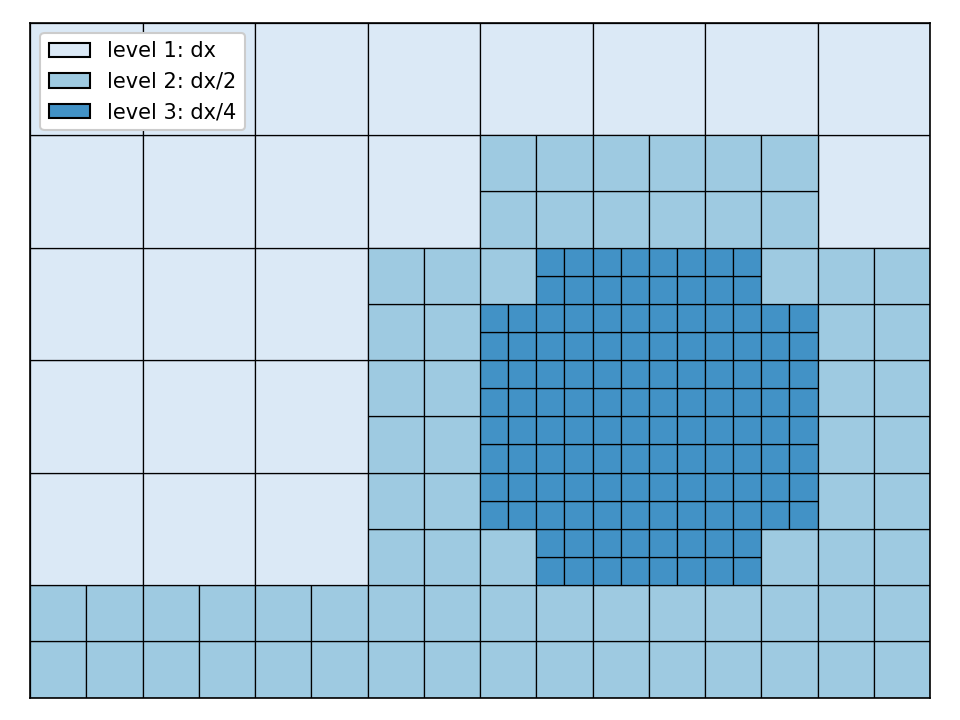
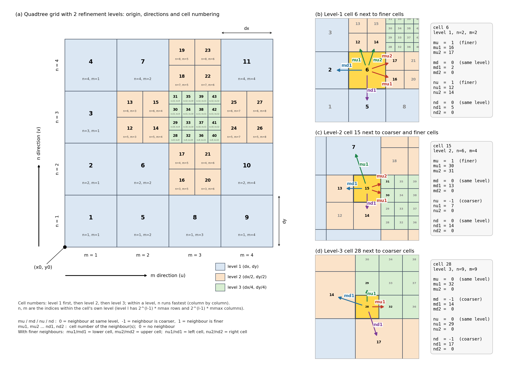

.. _quadtree:

User manual - Quadtree
======================

Overview
----------------------

On a regular grid all cells have the same size, so the resolution needed in the area of interest (e.g. a city or a narrow inlet) has to be used everywhere.
A quadtree grid avoids this: it starts from a coarse regular grid, and cells are split into 4 smaller cells (half the size in x- and y-direction) only where more detail is needed.
So basically, it is a quadtree refinement of a regular grid, where cells are only split when higher resolution is needed.
Splitting can be repeated, so a quadtree grid consists of several refinement levels:

* level 1 has the cell size of the coarse grid (dx, dy);
* level 2 has cells of dx/2 by dy/2;
* level n has cells of dx/2^(n-1) by dy/2^(n-1).

   Example of a quadtree grid with 3 refinement levels.

For example, with dx = dy = 400 m and 4 refinement levels, the cells are 400, 200, 100 and 50 m.
This typically reduces the number of active cells, and with that the runtime, by an order of magnitude compared to a regular grid at the finest resolution.

Rules and properties
----------------------

* Neighbouring cells differ at most 1 refinement level. So a coarse cell borders at most 2 finer cells on each side. HydroMT-SFINCS takes care of this when building the grid.
* The coarse grid is still defined by x0, y0, dx, dy, mmax, nmax and rotation, just like a regular grid (see :ref:`grid_characteristics` in 'User manual - General'). These values are stored in the quadtree file 'sfincs.nc', so they do not have to be specified in sfincs.inp anymore.
* Quadtree grids are typically combined with subgrid tables (sbgfile, see :ref:`subgrid_tables` in 'User manual - General'), so that the coarser cells still use the high-resolution elevation and roughness data.
* Water level boundary cells, observation points, discharge points, structures and all other input with x/y-coordinates work in the same way as on a regular grid; SFINCS finds the quadtree cell or cell interface at each location itself.
* Spatially varying input per cell (e.g. 'inffile', 'manningfile', 'inifile') must follow the cell order of the quadtree file; HydroMT-SFINCS writes these files in this order.
* The viscosity coefficient 'nuvisc' is multiplied with the cell size per refinement level, and at refinement level transitions it is increased by the factor 'nuviscfac' (default 100) to prevent instabilities.

   Even the SFINCS logo can be meshed: a quadtree grid refines along the edges of the letters and the SFINCS logo, and stays coarse elsewhere.

Quadtree file
----------------------

**qtrfile = sfincs.nc**

A quadtree grid is supplied to SFINCS in a single netcdf file, specified with 'qtrfile'.
When 'qtrfile' is given, the keywords mmax, nmax, dx, dy, x0, y0 and rotation, and the files 'depfile', 'mskfile' and 'indexfile' are not needed in sfincs.inp.
These inputs are then ignored. 

.. code-block:: text

	e.g. in sfincs.inp:

	qtrfile         = sfincs.nc
	sbgfile         = sfincs_subgrid.nc
	epsg            = 32633

The 'sfincs.nc'qtrfile follows the UGRID conventions (dimension 'mesh2d_nFaces' for the cells, https://ugrid-conventions.github.io/ugrid-conventions/) and contains:

* global attributes 'x0', 'y0', 'dx', 'dy', 'mmax', 'nmax', 'rotation' and 'nr_levels' describing the coarse grid;
* per cell: the refinement level ('level'), the indices within that level ('n', 'm'), the indices of the neighbouring cells in each direction ('mu', 'mu1', 'mu2', 'md', 'md1', 'md2', 'nu', 'nu1', 'nu2', 'nd', 'nd1', 'nd2'), the bed level ('z') and the mask ('mask', with the same values 6 as described in :ref:`mask_file` in 'User manual - General').

The cells are numbered per refinement level, starting with level 1. Within a level, n runs fastest, so the cells are numbered column by column.
The 'n' and 'm' indices of a cell count rows and columns of its own level, so level l has 2^(l-1) * nmax rows and 2^(l-1) * mmax columns.
For each direction (mu = right, md = left, nu = up, nd = down), the flag 'mu' is 0 when the neighbour has the same level, -1 when it is coarser and 1 when it is finer.
'mu1' and 'mu2' contain the numbers of the neighbouring cells (0 = no neighbour).
'mu2' is only used when there are 2 finer neighbours: 'mu1'/'md1' is then the lower cell and 'mu2'/'md2' the upper cell, and 'nu1'/'nd1' is the left cell and 'nu2'/'nd2' the right cell.

   Cell numbering and neighbour indices of a quadtree grid with 2 refinement levels. (a) Coarse grid with origin (x0, y0), m and n directions and cell numbers. (b)-(d) Neighbour flags and indices of a level-1, level-2 and level-3 cell.

Python example using HydroMT-SFINCS
-----------------------------------

In HydroMT-SFINCS the quadtree versions of the grid components are named 'quadtree_grid', 'quadtree_mask', 'quadtree_subgrid', etc.
They are used in the same way as their regular counterparts.
The refinement is specified with polygons with a column 'refinement_level', giving the number of times the cells within the polygon are split (so 'refinement_level' = 1 gives level 2 cells, of dx/2).
Optionally, a 'zmin' and/or 'zmax' column limits the refinement to cells with a bed level within that range.
To call functions like create grid, elevation, mask etc., one uses the 'sf.quadtree_*' modules instead of the regular 'sf.*' modules.

.. code-block:: python

	import geopandas as gpd
	from hydromt_sfincs import SfincsModel	

	sf = SfincsModel(root="sfincs_model", mode="w")

	# Polygons with a 'refinement_level' column, e.g. 1 along the coast and 2 in the city
	gdf_refinement = gpd.read_file("data/refinement_polygons.geojson")

	sf.quadtree_grid.create(
		x0=318650,
		y0=5040000,
		dx=200.0,
		dy=200.0,
		nmax=40,
		mmax=63,
		rotation=27,
		epsg=32633,
		refinement_polygons=gdf_refinement,
	)

	# Or, analogous to sf.grid.create_from_region:
	sf.quadtree_grid.create_from_region(
		region={"geom": "data/region.geojson"},
		res=200,
		rotated=True,
		crs="utm",
		refinement_polygons=gdf_refinement,
	)

	elevation_list = [{"elevation": "merit_hydro", "zmin": 0.001}, {"elevation": "gebco"}]
	roughness_list = [{"lulc": "vito_2015", "reclass_table": "vito_mapping.csv"}]

	# Bed level per quadtree cell, used to define the mask
	sf.quadtree_elevation.create(elevation_list=elevation_list)

	# Active cells and water level boundary cells
	sf.quadtree_mask.create_active(zmin=-5)
	sf.quadtree_mask.create_boundary(btype="waterlevel", zmax=-5)

	# Subgrid tables for all quadtree cells
	sf.quadtree_subgrid.create(
		elevation_list=elevation_list,
		roughness_list=roughness_list,
		nr_subgrid_pixels=8,
	)

	# Writes sfincs.nc (qtrfile), sfincs_subgrid.nc (sbgfile) and sfincs.inp
	sf.write()

	More information:
	https://deltares.github.io/hydromt_sfincs/latest/

Output
----------------------

Map output of a quadtree model is written on the quadtree mesh in 'sfincs_map.nc', which can for instance be directly visualised in QGIS.
In the special case of a quadtree file with only one refinement level, the map output is written as a regular grid, unless 'output_on_quadtree_mesh = 1' is specified.
For Python users that normally use 'xarray' for the visualisation of netcdf files, the quadtree map output *cannot* be used directly, as it does not follow a regular grid structure.
Instead, Python users can use Deltares' Python Package 'xugrid' (https://deltares.github.io/xugrid/index.html), to seamlessly work with quadtree-structured netcdf files.
Besides plotting 2D maps, 'xugrid' can also be used to extract point values, transects and other derived quantities from quadtree-structured netcdf files.
This is also what is used in HydroMT-SFINCS in sf.output.read(): for a quadtree model, each map output variable is returned as an 'xugrid.UgridDataArray'.

**Python example using HydroMT-SFINCS and xugrid**

.. code-block:: python

	import matplotlib.pyplot as plt
	import xugrid as xu
	from hydromt_sfincs import SfincsModel	

	# Open the model folder in read mode and read sfincs_map.nc and sfincs_his.nc
	sf = SfincsModel(root="sfincs_model", mode="r")
	sf.output.read()

	# Maximum water level on the quadtree mesh, for the last 'dtmaxout' window
	zsmax = sf.output.data["zsmax"].isel(timemax=-1)

	# Plot the 2D map, each quadtree cell is drawn with its own size
	fig, ax = plt.subplots(figsize=(8, 6))
	zsmax.ugrid.plot(ax=ax, cmap="Blues", vmin=0.0, vmax=3.0)
	ax.set_title("Maximum water level [m]")

	# Value of the quadtree cells containing two points
	zsmax_points = zsmax.ugrid.sel_points(x=[319500.0, 321000.0], y=[5045000.0, 5046500.0])

	# Values along a transect, from the cells the line intersects
	zsmax_transect = zsmax.ugrid.intersect_line(start=(319000.0, 5044000.0), end=(323000.0, 5048000.0))

	# Without HydroMT-SFINCS, xugrid can read the map output directly as well
	import xugrid as xu

	ds = xu.open_dataset("sfincs_model/sfincs_map.nc")
	ds["zsmax"].isel(timemax=-1).ugrid.plot()

	More information:
	https://deltares.github.io/xugrid/examples/quick_overview.html

